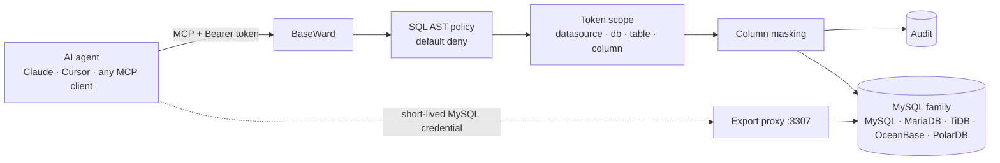

# BaseWard

**The warden between AI and your data.**

[English](README.md) | [简体中文](README.zh-CN.md)


BaseWard is an MCP-native database gateway for AI agents. It sits between your agents and any MySQL-family database — MySQL, MariaDB, Percona, Amazon Aurora, or a MySQL-compatible engine such as TiDB, OceanBase or PolarDB — and decides what they can see and do: per-token scopes down to the column, AST-based default-deny policy, column-level masking, fail-closed audit — and short-lived MySQL credentials for large exports.

- MCP endpoint: `POST /mcp` (Streamable HTTP, stateless)
- Admin console: `/admin` (Chinese and English)
- Health check: `/healthz`
- Runtime: Python 3.12+ / Docker

## Why

An agent holding a database connection string can read every table, ignore your PII rules, and leave nothing behind but the database's own logs. A shared read-only user is safer, but it is all-or-nothing and everyone gets the same one.

BaseWard keeps the connection string on the server and gives each agent a revocable token instead.

| Risk | Direct connection | Shared read-only user | BaseWard |
|---|---|---|---|
| Credential scope | whole instance | whole instance | datasource → database → table → column |
| Statements | anything the account can run | anything read-only | AST default-deny; writes only on explicitly writable databases |
| PII | none | none | automatic + manual column masking |
| Audit | database logs at best | database logs at best | per-call intent and result; queries are blocked when audit is unavailable |
| Large result sets | agent memory | agent memory | truncated preview + short-lived streaming credential |
| Revocation | rotate the password | rotate it for everyone | disable one token, effective immediately |

## How it works



## Supported databases

BaseWard speaks the MySQL wire protocol and the MySQL SQL dialect, so the whole MySQL family is in
scope rather than one product: MySQL 8.0 / 5.7 / 8.4, MariaDB, Percona Server, Amazon Aurora MySQL
and RDS MySQL, plus the MySQL-compatible distributed engines — PingCAP TiDB, OceanBase, Alibaba
PolarDB, Tencent TDSQL, ZTE GoldenDB and Huawei GaussDB(for MySQL).

Two claims are deliberately kept apart:

- **Protocol compatibility** — BaseWard can connect, read metadata and stream results.
- **Policy verification** — default-deny, token scopes, masking and fail-closed audit have been
  executed against that engine and asserted in tests.

MySQL 8.0, MariaDB 11.8, TiDB v8.5 and OceanBase CE 4.4 are in the verified column today, each
backed by the same 243-test run recorded in [docs/compatibility.md](docs/compatibility.md).
OceanBase comes with two deployment conditions: the pool issues `SET autocommit=0` at connect time
because the engine ignores the handshake flag, and its 10 s default `ob_query_timeout` has to be
raised for large reads. The remaining engines are expected to work, and that document lists exactly
which deltas to check per engine and the command that checks them.

Non-MySQL dialects are not supported as datasources: PostgreSQL, SQL Server, Oracle, ClickHouse, and
the PG-derived or Oracle-compatible domestic engines (openGauss/GaussDB, Dameng, KingBase).
PostgreSQL datasources are on the roadmap.

The management database — BaseWard's own metadata store — defaults to a local SQLite file. You can
instead point it at an external MySQL or PostgreSQL instance (both are tested: MySQL 8.0 and
PostgreSQL 16); see [docs/configuration.md](docs/configuration.md).

## Quick start

Prerequisites: Docker with Compose v2. No external database is required: the management store is a
SQLite file kept in the `gateway-data` volume.

1. Configure and start:

```bash
git clone https://github.com/billsking/baseward.git
cd baseward
cp .env.example .env
python scripts/gen_master_key.py   # paste the output into GATEWAY_MASTER_KEY
# edit .env: fill GATEWAY_ADMIN_PASSWORD (the first admin is created on first start)
docker compose up -d --build
curl http://127.0.0.1:8080/healthz  # {"status":"ok"}
```

On first start the schema is created automatically, and an admin account is seeded from
`GATEWAY_ADMIN_USER` / `GATEWAY_ADMIN_PASSWORD` while the management store has no admin yet.

2. Open `http://<host>:8080/admin`, add a datasource, create a token, then point your MCP client at `http://<host>:8080/mcp`:

```json
{
  "mcpServers": {
    "baseward": {
      "type": "streamableHttp",
      "url": "http://<host>:8080/mcp",
      "headers": {"Authorization": "Bearer gw_xxxxxxxx"}
    }
  }
}
```

### Using an external management database

SQLite fits single-instance, low-concurrency deployments. For multiple replicas or production, use
MySQL (or PostgreSQL) with either setting:

- `GATEWAY_DB_URL` — a full async SQLAlchemy URL, for example
  `mysql+aiomysql://dbgw:<password>@127.0.0.1:3306/db_gateway?charset=utf8mb4`. PostgreSQL accepts
  `postgresql://...` (upgraded to the asyncpg driver) and additionally needs `asyncpg` installed.
- `GATEWAY_DB_HOST` / `GATEWAY_DB_PORT` / `GATEWAY_DB_USER` / `GATEWAY_DB_PASSWORD` /
  `GATEWAY_DB_NAME` — the MySQL shorthand.

For a MySQL management database, create it and the account first:

```sql
CREATE DATABASE db_gateway CHARACTER SET utf8mb4 COLLATE utf8mb4_unicode_ci;
CREATE USER 'dbgw'@'%' IDENTIFIED BY '<strong-password>';
GRANT CREATE, ALTER, INDEX, REFERENCES, SELECT, INSERT, UPDATE, DELETE ON db_gateway.* TO 'dbgw'@'%';
```

The DDL grants are required because `migrations/*.sql` are replayed at startup. Other backends build
their schema from the ORM metadata and need no DDL grants.

When MySQL is on the same host, set `GATEWAY_DB_HOST=host.docker.internal` (compose already maps it;
Docker 20.10+ is required). `127.0.0.1` inside the container points at the container itself.

> A one-command demo with generated secrets is next on the roadmap.

## Capabilities

| Capability | What it does |
|---|---|
| Five MCP tools | `list_datasources`, `describe_datasource`, `search_objects`, `execute_sql`, `issue_export_credential` |
| Token scopes | datasource → database → table → column; an empty level means everything at that level, never beyond the datasource's exposed databases; `SELECT *` is rewritten to the allowed columns |
| SQL policy | AST default deny: DDL, `GRANT`, `CALL`, multi-statement, locking reads, `INTO OUTFILE`, and writes without `WHERE` |
| Multi-database | one datasource exposes several schemas; usable = exposed ∩ authorized; read/write is decided per database |
| Upstream engines | the MySQL protocol family: MySQL, MariaDB, Percona, Aurora/RDS MySQL, TiDB, OceanBase, PolarDB, TDSQL — policy verified on MySQL 8.0, MariaDB 11.8, TiDB v8.5 and OceanBase CE 4.4, see [docs/compatibility.md](docs/compatibility.md) |
| Masking | automatic keyword detection (phone, email, ID card, name, address, password) plus manual `mask/hash/null/off` rules |
| Audit | intent is written before execution and updated afterwards; execution is blocked when the audit store is unavailable |
| Export credentials | read-only MySQL-protocol proxy bound to the source IP; oversized MCP results hand off automatically |
| Admin console | datasources, policies, masking rules, token scopes, audit search, settings; Chinese/English UI chosen from `?lang=`, a cookie or `Accept-Language`; CSRF protection and HttpOnly sessions |

## MCP tools

| Tool | Purpose |
|---|---|
| `list_datasources` | List datasources and the databases each token can use |
| `describe_datasource` | Tables, columns, comments and primary keys in one call |
| `search_objects` | Keyword search over table/column names and comments |
| `execute_sql` | Run a single statement under policy, scope and masking |
| `issue_export_credential` | Exchange a `SELECT` for a short-lived MySQL credential |

Tool schemas, authorization rules and error codes: [docs/mcp-tools.md](docs/mcp-tools.md). Export protocol: [docs/export-credential.md](docs/export-credential.md).

## Security model

- The database account stays on the server; agents only ever hold a revocable token.
- Default deny for statements, tables, columns and databases.
- Masking happens before results leave the gateway; the audit record keeps the SQL, status and timing.
- Fail-closed: when the audit store is unavailable, queries are denied.
- Application policy is not a replacement for database least privilege — grant the upstream account only what it needs.
- The gateway itself speaks HTTP; terminate TLS in a reverse proxy in front of it.

Known limitations — no TLS inside the gateway, the master key cannot be rotated yet, no row-level rules, one token per user, no rate limiting — are listed with code evidence in [SECURITY.md](SECURITY.md).

## Roadmap

- One-command demo: `docker compose up` with a bundled MySQL and generated secrets
- Compatibility matrix executed in CI for the MySQL family (MariaDB, TiDB, OceanBase, PolarDB), so
  rows in [docs/compatibility.md](docs/compatibility.md) move from *expected* to *verified*
- PostgreSQL support (and the engine abstraction it needs first)
- Token expiry and rotation, multiple tokens per user
- Prometheus metrics
- Row-level rules, SSO/OIDC (enterprise)

## Documentation

Every document below exists in both English and Chinese; each page carries a language switcher at
the top. The two benchmark reports under `docs/` are generated by `tests/perf/` and stay
Chinese-only.

- [docs/configuration.md](docs/configuration.md) — environment variables
- [docs/admin-ui.md](docs/admin-ui.md) — admin console
- [docs/mcp-tools.md](docs/mcp-tools.md) — tool schemas and error codes
- [docs/export-credential.md](docs/export-credential.md) — MySQL export protocol
- [docs/deployment.md](docs/deployment.md) — deployment, acceptance checklist, limitations
- [docs/compatibility.md](docs/compatibility.md) — engines in scope, and which ones are actually verified
- [docs/development.md](docs/development.md) — local development and tests
- [docs/architecture.md](docs/architecture.md) — source layout
- [SECURITY.md](SECURITY.md) — threat model and known limitations

## License

Apache License 2.0 — see [LICENSE](LICENSE).

Copyright 2026 The BaseWard Authors.
