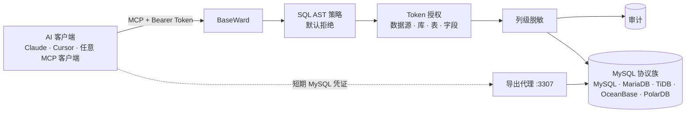

# BaseWard（库卫）

**AI 与数据之间的守门人。**

[English](README.md) | [简体中文](README.zh-CN.md)


BaseWard 是面向 AI 客户端的 MCP 数据库网关。它挡在你的 Agent 和任意 MySQL 协议族数据库之间——MySQL、MariaDB、Percona、Amazon Aurora，以及 TiDB、OceanBase、PolarDB 这些 MySQL 兼容引擎（含国产分布式数据库）——决定 Agent 能看什么、能做什么：按 Token 收敛到列级的授权、基于 SQL AST 的默认拒绝策略、列级脱敏、审计不可用即拒绝，以及给大结果集准备的短期 MySQL 凭证。

- MCP 端点：`POST /mcp`（Streamable HTTP，无状态）
- 管理端：`/admin`
- 健康检查：`/healthz`
- 运行时：Python 3.12+ / Docker

## 为什么需要

把数据库连接串直接交给 Agent，等于让它能读全部表、绕过你的脱敏规定，而且除了数据库自己的日志什么都不留。共享一个只读账号安全一些，但它全有或全无，所有人共用同一把钥匙。

BaseWard 把连接串留在服务端，只给每个 Agent 发一个可随时吊销的 Token。

| 风险 | 直连数据库 | 共享只读账号 | BaseWard |
|---|---|---|---|
| 凭证范围 | 整个实例 | 整个实例 | 数据源 → 库 → 表 → 字段 |
| 可执行语句 | 账号能跑的全部 | 全部只读语句 | AST 默认拒绝；只有显式可写的库才能写 |
| 敏感数据 | 无 | 无 | 自动 + 手动列级脱敏 |
| 审计 | 最多只有数据库日志 | 最多只有数据库日志 | 每次调用记录意图与结果；审计不可用时拒绝执行 |
| 大结果集 | 堆在 Agent 内存里 | 堆在 Agent 内存里 | 返回截断预览 + 短期流式凭证 |
| 吊销 | 改密码 | 所有人一起换 | 停用单个 Token，立即生效 |

## 工作方式



## 支持的数据库

BaseWard 说 MySQL 线路协议与 MySQL SQL 方言，因此覆盖的是整个 MySQL 协议族，而不只是某一个产品：MySQL 8.0 / 5.7 / 8.4、MariaDB、Percona Server、Amazon Aurora MySQL 与 RDS MySQL，以及 MySQL 兼容的分布式引擎——PingCAP TiDB、OceanBase、阿里云 PolarDB、腾讯云 TDSQL、中兴 GoldenDB、华为 GaussDB(for MySQL)。

这里刻意区分两种说法：

- **协议兼容**——BaseWard 能连上、能读元数据、能流式回写结果。
- **策略已验证**——默认拒绝、Token 四级授权、脱敏、审计 fail-closed 已经在该引擎上真实跑过并被断言。

目前「已验证」一栏有 MySQL 8.0、MariaDB 11.8、TiDB v8.5、OceanBase CE 4.4，每一条都对应 [docs/compatibility.zh-CN.md](docs/compatibility.zh-CN.md) 里记录的同一套 243 条实测运行。OceanBase 有两个部署前提：连接池在建连时执行 `SET autocommit=0`（它忽略握手里的该标志，不补这一步审计 fail-closed 不成立）；默认 10s 的 `ob_query_timeout` 会掐断大结果集读取，实测时调到 600s。其余引擎属于「预期可用」，逐个引擎要核对哪些差异、用什么命令核对，见同一份文档。

非 MySQL 方言不作为**业务数据源**支持：PostgreSQL、SQL Server、Oracle、ClickHouse，以及 PG 系或 Oracle 兼容的国产引擎（openGauss/GaussDB、达梦、人大金仓）。PostgreSQL 数据源在路线图上。

管理库（BaseWard 自身的元数据库）默认使用本地 SQLite 文件，也可以改用外部 MySQL 或 PostgreSQL（两者均已实测：MySQL 8.0、PostgreSQL 16），配置见 [docs/configuration.zh-CN.md](docs/configuration.zh-CN.md)。

## 快速开始

前提：Docker 与 Compose v2。不需要任何外部数据库：管理库默认是 `gateway-data` 数据卷里的 SQLite 文件。

1. 配置并启动：

```bash
git clone https://github.com/billsking/baseward.git
cd baseward
cp .env.example .env
python scripts/gen_master_key.py   # 输出填入 GATEWAY_MASTER_KEY
# 编辑 .env：填 GATEWAY_ADMIN_PASSWORD（首次启动创建管理员）
docker compose up -d --build
curl http://127.0.0.1:8080/healthz  # {"status":"ok"}
```

首次启动会自动建表，并在管理库还没有管理员时用 `GATEWAY_ADMIN_USER` / `GATEWAY_ADMIN_PASSWORD` 创建管理员。

2. 打开 `http://<服务器IP>:8080/admin`，新建数据源、创建 Token，然后在 MCP 客户端里指向 `http://<服务器IP>:8080/mcp`：

```json
{
  "mcpServers": {
    "baseward": {
      "type": "streamableHttp",
      "url": "http://<服务器IP>:8080/mcp",
      "headers": {"Authorization": "Bearer gw_xxxxxxxx"}
    }
  }
}
```

### 使用外部数据库作为管理库

SQLite 只适合单实例、低并发；多副本或生产部署请改用 MySQL（或 PostgreSQL）。两种等价写法，任选其一：

- `GATEWAY_DB_URL` —— 完整的 SQLAlchemy 异步 URL，例如
  `mysql+aiomysql://dbgw:<密码>@127.0.0.1:3306/db_gateway?charset=utf8mb4`；PostgreSQL 写
  `postgresql://...`（自动升级到 asyncpg 驱动），并需自行安装 `asyncpg`。
- `GATEWAY_DB_HOST` / `GATEWAY_DB_PORT` / `GATEWAY_DB_USER` / `GATEWAY_DB_PASSWORD` / `GATEWAY_DB_NAME` —— MySQL 专用简写。

MySQL 作为管理库时，先建库建账号：

```sql
CREATE DATABASE db_gateway CHARACTER SET utf8mb4 COLLATE utf8mb4_unicode_ci;
CREATE USER 'dbgw'@'%' IDENTIFIED BY '<强密码>';
GRANT CREATE, ALTER, INDEX, REFERENCES, SELECT, INSERT, UPDATE, DELETE ON db_gateway.* TO 'dbgw'@'%';
```

启动时会按文件名顺序重放 `migrations/*.sql`，所以账号需要上述 DDL 权限；非 MySQL 后端由 ORM 元数据建表，不需要 DDL 权限。

管理库在容器外时，`GATEWAY_DB_HOST` 填 MySQL 地址。MySQL 装在部署机本机时填 `host.docker.internal`（compose 已配 `extra_hosts`，需 Docker 20.10+）——容器里的 `127.0.0.1` 指向容器自己。

> 自动生成密钥的一键演示正在路线图中。

## 能力

| 能力 | 说明 |
|---|---|
| 五个 MCP 工具 | `list_datasources`、`describe_datasource`、`search_objects`、`execute_sql`、`issue_export_credential` |
| Token 授权 | 数据源 → 库 → 表 → 字段四级；任一层留空表示该层全部，但任何「全部」都不越过数据源的可访问库；`SELECT *` 自动改写为允许字段 |
| SQL 策略 | AST 默认拒绝：DDL、`GRANT`、`CALL`、多语句、锁读、`INTO OUTFILE`、无 `WHERE` 写 |
| 多库数据源 | 一个数据源暴露同实例多个库；可用库 = 可访问库 ∩ 已授权库；读写按库独立判定 |
| 上游引擎 | MySQL 协议族：MySQL、MariaDB、Percona、Aurora/RDS MySQL、TiDB、OceanBase、PolarDB、TDSQL——策略在 MySQL 8.0、MariaDB 11.8、TiDB v8.5、OceanBase CE 4.4 上实测通过，OceanBase 的两个部署前提见 [docs/compatibility.zh-CN.md](docs/compatibility.zh-CN.md) |
| 脱敏 | 按列名自动识别 phone/email/身份证/姓名/地址/密码等；支持手动 `mask/hash/null/off` |
| 审计 | 执行前写意图、结束更新状态；审计库不可用时拒绝执行 |
| 导出凭证 | MySQL 协议只读代理，凭证绑定来源 IP；MCP 结果超限时自动交接 |
| 管理端 | 数据源、策略、脱敏、Token 授权、审计检索、设置；中英双语（`?lang=`、Cookie 或 `Accept-Language`）；CSRF 校验与 HttpOnly 会话 |

## MCP 工具

| 工具 | 用途 |
|---|---|
| `list_datasources` | 列出数据源与该 Token 可用的库 |
| `describe_datasource` | 一次拿到表、字段、注释与主键 |
| `search_objects` | 按关键词搜索表名、字段名与注释 |
| `execute_sql` | 在策略、授权与脱敏约束下执行单条 SQL |
| `issue_export_credential` | 用一条 SELECT 换短期 MySQL 只读凭证 |

工具参数、授权口径与错误码见 [docs/mcp-tools.zh-CN.md](docs/mcp-tools.zh-CN.md)；导出协议见 [docs/export-credential.zh-CN.md](docs/export-credential.zh-CN.md)。

## 安全模型

- 数据库账号留在服务端，Agent 手里只有可吊销的 Token。
- 语句、表、字段、库四个维度都是默认拒绝。
- 脱敏在结果离开网关前完成；审计保留 SQL、状态与耗时。
- Fail-closed：审计库不可用时拒绝执行。
- 应用层策略不能替代数据库最小权限，上游账号只授予它真正需要的权限。
- 网关自身只监听 HTTP，生产环境必须在前面用反代终止 TLS。

已知限制（网关内无 TLS、主密钥暂不支持轮换、无行级规则、每用户单 Token、无限流）在 [SECURITY.zh-CN.md](SECURITY.zh-CN.md) 中逐条给出代码证据。

## 路线图

- 一键演示：`docker compose up` 内置 MySQL 并自动生成密钥
- 在 CI 里跑通 MySQL 协议族兼容性矩阵（MariaDB、TiDB、OceanBase、PolarDB），让 [docs/compatibility.zh-CN.md](docs/compatibility.zh-CN.md) 状态表里的行从「预期」变成「已验证」
- PostgreSQL 支持（以及它前置需要的引擎抽象改造）
- Token 过期与轮换、每用户多 Token
- Prometheus 指标
- 行级权限、SSO/OIDC（企业版）

## 文档

下面每份文档都有中英两版，页面顶部有语言切换链接。`docs/` 下两份压测报告是 `tests/perf/` 的生成物，只有中文版。

- [docs/configuration.zh-CN.md](docs/configuration.zh-CN.md) — 环境变量
- [docs/admin-ui.zh-CN.md](docs/admin-ui.zh-CN.md) — 管理端功能
- [docs/mcp-tools.zh-CN.md](docs/mcp-tools.zh-CN.md) — MCP 工具与错误码
- [docs/export-credential.zh-CN.md](docs/export-credential.zh-CN.md) — MySQL 导出协议
- [docs/deployment.zh-CN.md](docs/deployment.zh-CN.md) — 部署要求、验收清单、已知限制
- [docs/compatibility.zh-CN.md](docs/compatibility.zh-CN.md) — 支持哪些引擎、哪些已实测
- [docs/development.zh-CN.md](docs/development.zh-CN.md) — 本机开发与测试
- [docs/architecture.zh-CN.md](docs/architecture.zh-CN.md) — 目录结构
- [SECURITY.zh-CN.md](SECURITY.zh-CN.md) — 威胁模型与已知限制

## 许可证

本项目采用 [Apache License 2.0](LICENSE) 许可。

Copyright 2026 The BaseWard Authors。
